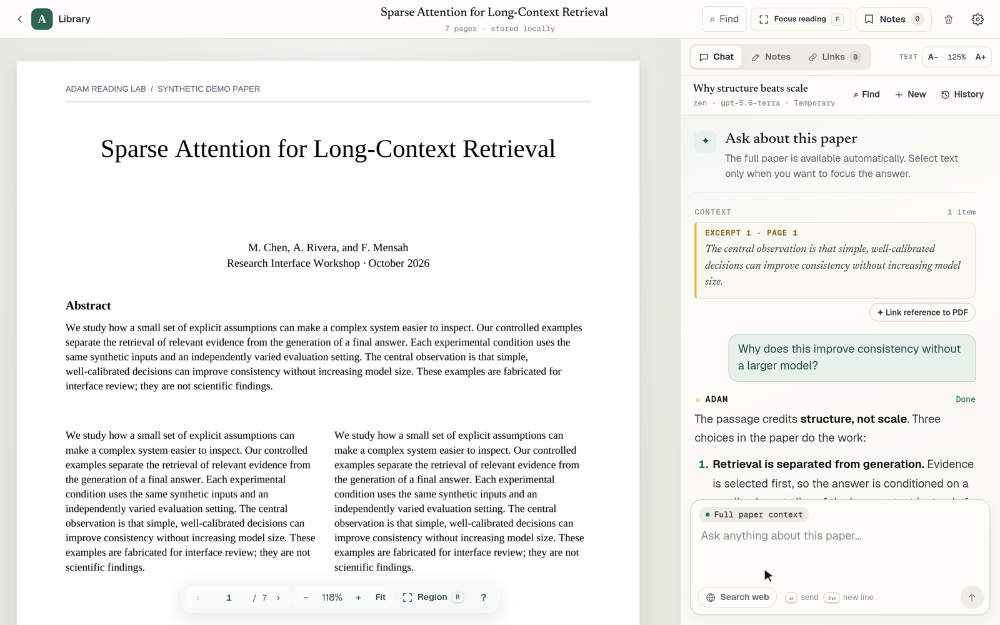
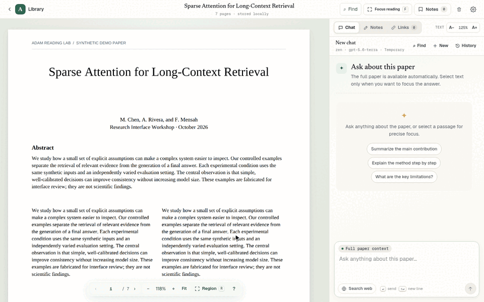
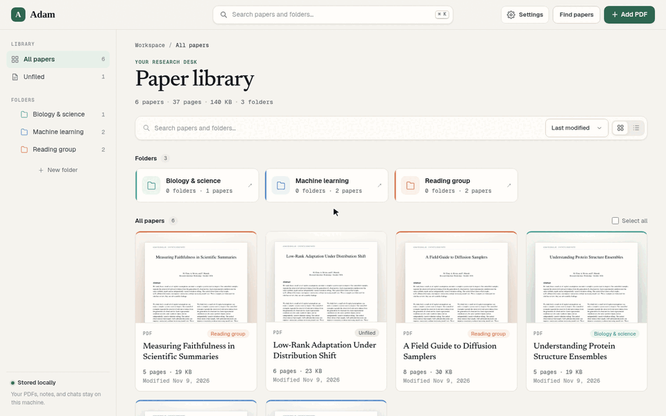
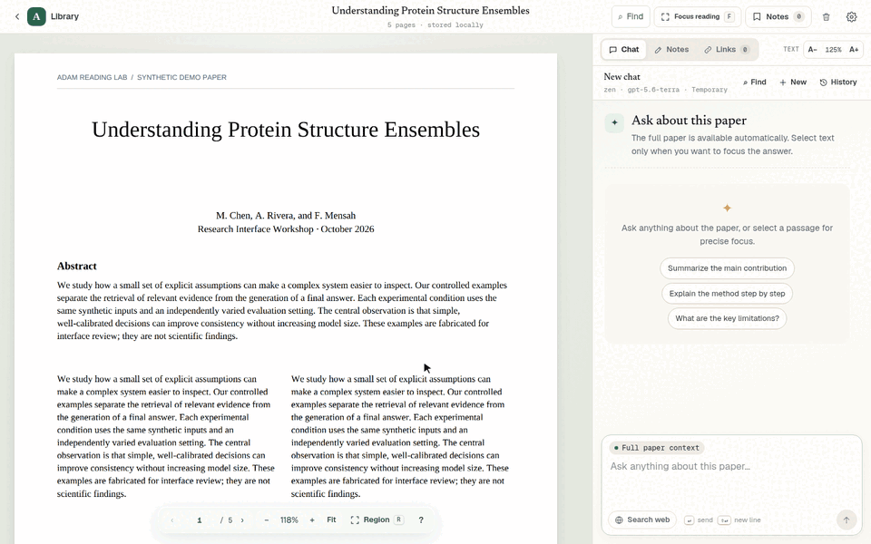
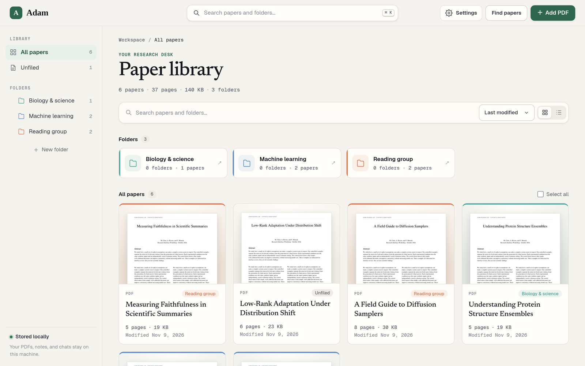
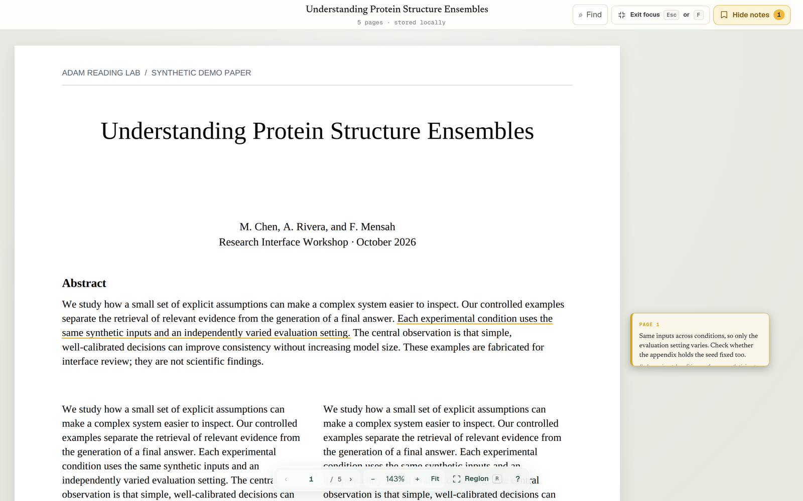
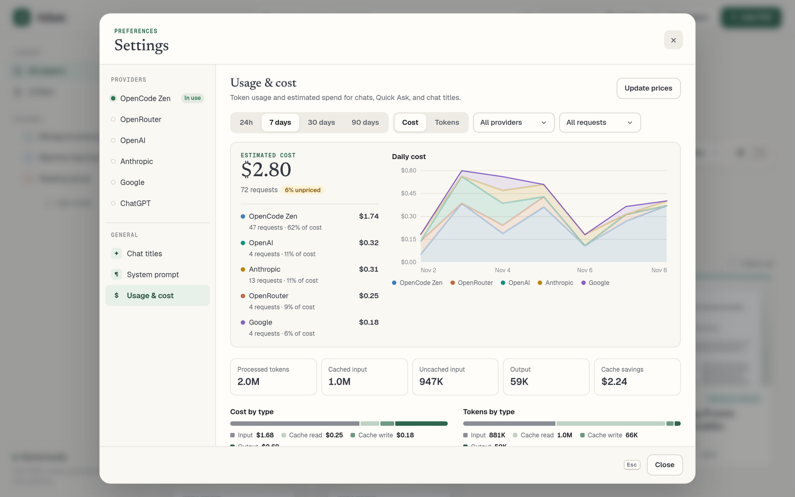

# Adam

**A self-hosted research-paper reader with an AI that has read the paper too.**

Adam keeps your PDFs, notes, and chats on your own machine. Open a paper, select any passage, figure, or equation, and ask about it. The model sees the full paper, so its answers stay grounded in what you are reading. You choose the model: bring an API key from OpenCode Zen, OpenRouter, OpenAI, Anthropic, or Google, or sign in with your ChatGPT plan.



- [Features](#features)
- [Requirements](#requirements)
- [Quick start](#quick-start)
- [Configuration](#configuration)
- [Keyboard shortcuts](#keyboard-shortcuts)
- [Your data](#your-data)
- [Development](#development)

## Features

### Ask about any passage

Select text in the PDF and add it to the chat, or press **R** to drag over a figure or equation. Adam always sends the full paper text; your selections tell the model what to focus on. Answers stream in, render Markdown and math, and are saved per paper, so you can come back to any conversation later.



- **Quick Ask** (**A**) answers a question about a selection in a small floating window, without leaving your place. You can move the thread into the main chat afterwards.
- **Search web** lets the model run a web search through a bundled SearXNG instance and cite its sources. The sources stay available for follow-up questions in that chat.
- **Chat history** for each paper is searchable across titles, questions, and answers. Chats get automatic titles, and unsent drafts are saved.
- **Link reference to PDF** pins an answer to the passage it was about, so you can jump between the two.

### Find and import papers

Search arXiv and the web from inside Adam (**⌘/Ctrl + Shift + K**), review a result, pick a folder, and download it into your library. You can also paste a link to any public PDF. Adam checks that the file is a real PDF before adding it, and importing the same PDF twice reuses the copy you already have.



### Notes with source quotes

Each paper has a rich-text note beside it. Select text in the PDF and press **Q** to insert it as a quote with its page citation. **Show in PDF** scrolls back to the quoted passage and highlights it. You can also highlight in four colors (**1–4**) and attach short notes to passages (**N**).



### A library that stays organized

Upload PDFs or import them from the web, then sort them into nested, color-coded folders with drag and drop. Switch between grid and list views, search with **⌘/Ctrl + K**, and pick up where you left off with **Continue reading**, which remembers your page, scroll position, and zoom.



### Focus reading

Press **F** to hide everything except the paper. Toggle **Notes** to show your anchored notes beside the page, and press **Esc** to return to your workspace exactly as you left it.



### Usage and cost tracking

**Settings → Usage & cost** shows token usage and estimated spend by provider, model, and day, including cache hits and savings. Prices come from public price lists and you can override them. Prompts and answers are never copied into usage records. See [Usage and cost](docs/usage-and-cost.md) for how costs are estimated.



## Requirements

- **Docker** with Docker Compose v2 (Docker Desktop, or Docker Engine with the Compose plugin).
- **An AI provider** for chat. Any one of:
  - an API key for [OpenCode Zen](https://opencode.ai/zen) (the default), [OpenRouter](https://openrouter.ai), [OpenAI](https://platform.openai.com), [Anthropic](https://console.anthropic.com), or [Google AI Studio](https://aistudio.google.com), or
  - a ChatGPT **Plus or Pro** plan, used through [Sign in with ChatGPT](docs/chatgpt-subscription.md).

  Everything except chat (library, reader, notes, search) works without a provider.
- **Free local ports** 3000 (web app), 8888 (search), and 1455 (ChatGPT sign-in callback). Each can be changed in `.env`.

To run Adam without Docker for development, you also need Python 3.12 and Node.js 22.13 or later. See [Development](#development).

## Quick start

```sh
git clone https://github.com/chenkuanliao/Adam.git
cd Adam
cp .env.example .env
mkdir -p secrets
# Paste your OpenCode Zen key into this file, or leave it empty to use another provider.
touch secrets/opencode_api_key
chmod 600 secrets/opencode_api_key
docker compose up --build -d
```

Open <http://localhost:3000>, upload a PDF, and start asking questions.

If you left `secrets/opencode_api_key` empty, open **Settings** (**⌘/Ctrl + ,**), choose a provider, paste its API key, and click **Apply model**. For a ChatGPT plan, follow [ChatGPT subscription](docs/chatgpt-subscription.md).

To update to a newer version:

```sh
git pull
docker compose up --build -d
```

Containers are rebuilt and your data in `./data` is kept.

## Configuration

Most settings live in the app, under **Settings** (**⌘/Ctrl + ,**):

| Section | What it controls |
| --- | --- |
| **Providers** | API keys and the chat model for OpenCode Zen, OpenRouter, OpenAI, Anthropic, Google, and ChatGPT. Each conversation remembers the provider, model, and system prompt it started with. |
| **Chat titles** | A separate provider and model for automatic chat titles. Defaults to OpenCode Zen with `gpt-6-luna`. |
| **System prompt** | The instructions sent with every chat and with Quick Ask. |
| **Usage & cost** | Token usage and estimated spend. See [Usage and cost](docs/usage-and-cost.md). |

Settings are saved in `./data/settings.json` and survive rebuilds. API keys stay on the server and are never sent back to the browser. A Zen key entered in Settings takes precedence over `secrets/opencode_api_key`; removing it falls back to the file.

Ports and the default Zen model are set in `.env`:

| Variable | Default | Purpose |
| --- | --- | --- |
| `ADAM_WEB_PORT` | `3000` | Port of the web app |
| `ADAM_SEARCH_PORT` | `8888` | Port of the bundled SearXNG search service (localhost only) |
| `ADAM_CHATGPT_CALLBACK_PORT` | `1455` | Port for the Sign in with ChatGPT callback |
| `ADAM_OPENCODE_MODEL` | `gpt-5.6-terra` | Default OpenCode Zen chat model |

**Web search** is off for each new question until you turn on **Search web** in the composer. It uses the bundled SearXNG container, so it needs no search API key. Each answer can draw on up to five results, with up to 7,500 characters of text from each.

To run a second copy from another checkout, give it its own Compose project name and ports:

```sh
ADAM_WEB_PORT=3001 ADAM_SEARCH_PORT=8889 docker compose -p adam-2 up --build -d
```

Each checkout keeps its own `./data` and `./secrets`.

## Keyboard shortcuts

Press **?** in the reader to see these at any time.

| Keys | Action |
| --- | --- |
| **1 – 4** | Highlight the selection |
| **C** | Add the selection to the chat context |
| **A** | Quick Ask about the selection |
| **N** | Attach a note to the selection |
| **Q** | Quote the selection in the paper note |
| **R** | Capture a region of the page (figures, equations) |
| **F** / **Esc** | Enter / leave focus reading |
| **⌘/Ctrl + F** | Find in the PDF |
| **⌘/Ctrl + Shift + F** | Search the chat or chat history |
| **⌘/Ctrl + K** | Search your library (press again to switch to online search and Add from link) |
| **⌘/Ctrl + Shift + K** | Find papers online |
| **⌘/Ctrl + ,** | Open Settings |
| **⌘/Ctrl + / −** | Zoom the focused pane (PDF, chat, or notes) |
| **⌘/Ctrl + Z** | Undo a highlight (add **Shift** to redo) |

For more detail on folders, reader controls, chats, and notes, see the [user guide](docs/user-guide.md).

## Your data

Everything Adam stores is in `./data` on your machine, outside the containers: PDFs, extracted text, the SQLite database (library, notes, chats, usage), settings, and ChatGPT sign-in credentials. Adam only goes online for things you ask it to do (AI requests, web and paper searches, PDF imports) and to refresh public model price lists once a day.

- **Do not delete `./data` when upgrading.** `docker compose down` and `docker compose up --build -d` keep it.
- **To back up**, stop Adam (`docker compose down`) and copy `./data`.
- **Single user.** Adam has no login. Run it on your own machine or a private network such as Tailscale, not the public internet.

## Development

See [docs/development.md](docs/development.md) to run the backend and frontend directly, seed demo data, and run the tests. [ARCHITECTURE.md](ARCHITECTURE.md) describes the design and roadmap.
