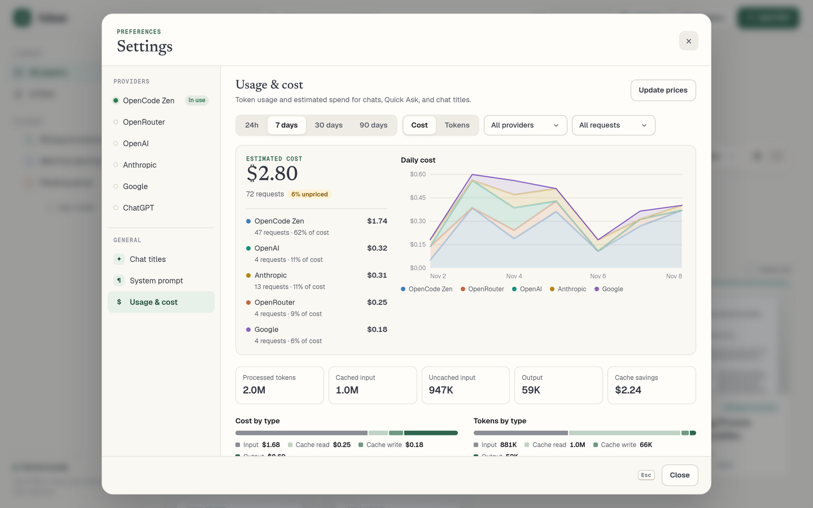

# Usage and cost

[← Back to README](../README.md)

Open **Settings → Usage & cost** (in the Settings dialog, under General) to see token usage and estimated spend by provider, model, and day for the past 24 hours, 7, 30, or 90 days. Switch between **Cost** and **Tokens**, filter by provider or request type (chat, Quick Ask, chat titles), and click a model for its cost, tokens, cost per 1M tokens, cache hit rate, trend, and cost/token mix.

- **What is tracked:** every model call Adam makes — chat answers, Quick Ask, chat-title generation, and web-search query planning (counted with the chat or Quick Ask that triggered it). Each call stores only token counts, provider, model, time, and the paper/chat it belonged to, in the local SQLite database. Prompts and answers are not copied into usage records. Deleting a paper or chat keeps its usage history.
- **History starts when this version is installed.** Earlier requests were never measured and cannot be reconstructed.
- **Token categories:** uncached input, cache reads, cache writes, and output. Reasoning/thinking tokens are shown but are already part of output, so they are never charged twice. A call that is stopped or fails after the provider reported usage is still recorded.
- **Costs are estimates recomputed from current prices**, not stored amounts, so price updates and overrides also apply to past usage. Prices come from [LiteLLM's price list](https://github.com/BerriAI/litellm/blob/main/model_prices_and_context_window.json) and, for OpenCode Zen, Zen's own prices via [models.dev](https://models.dev). Both are cached in `./data/pricing`, refreshed every 24 hours, and kept when a refresh fails; **Refresh prices** forces an update (at most once a minute). OpenRouter's reported per-request cost is used as-is. Usage of a model with no known price is shown as **Unpriced** and counts as $0 — Adam never guesses. Cache savings are cache-read tokens × (input price − cache-read price). Context-length price tiers and batch/priority discounts are not applied.
- **Price overrides:** choose **Set price** on an unpriced model, **Set price**/**Edit price** in a model's details, or **Add price** under *Your model prices*. Enter USD per 1M tokens for input and output, and optionally cache read and cache write (both default to the input price). Overrides win over published and provider-reported prices and are saved in `./data/settings.json`.
- **Prompt caching:** Anthropic Claude requests mark the system prompt, which contains the paper, as cacheable, so follow-up questions about the same paper within about five minutes read it from the cache at a fraction of the input price. OpenAI, Gemini, and most Zen models cache repeated prompts automatically.

For development only, `scripts/seed-usage-demo.py` can add clearly marked synthetic usage (and `--clear` removes it). See [development.md](development.md#demo-data).
